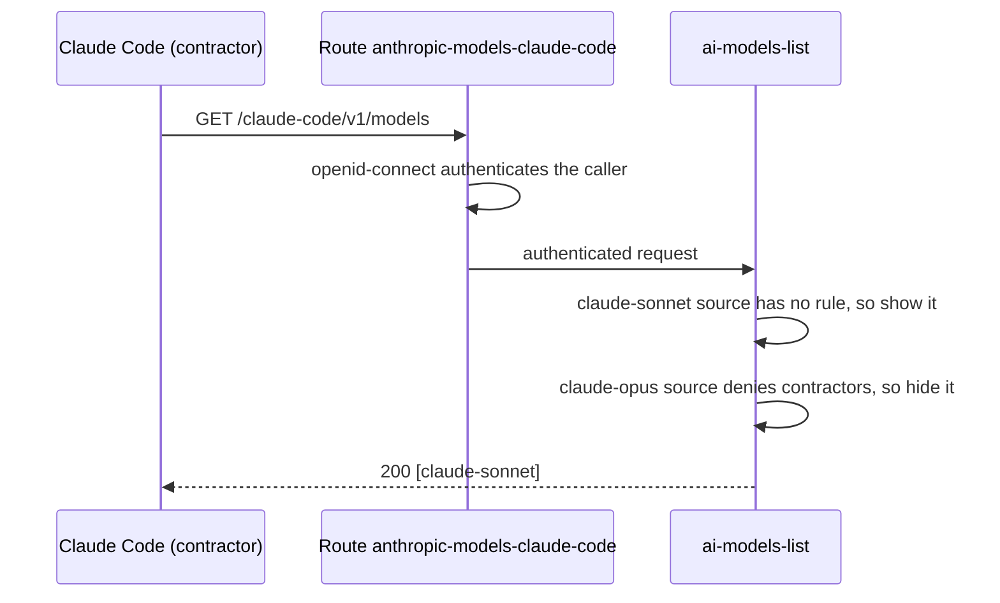
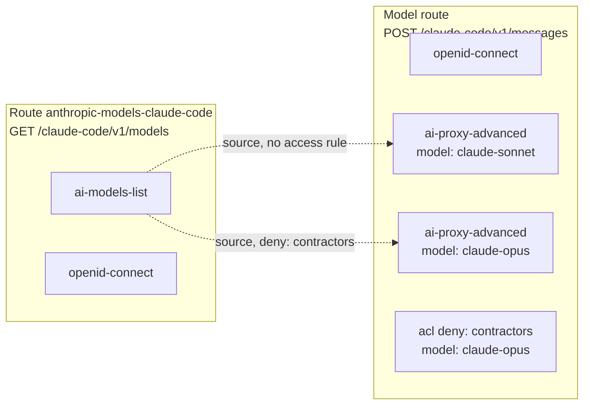
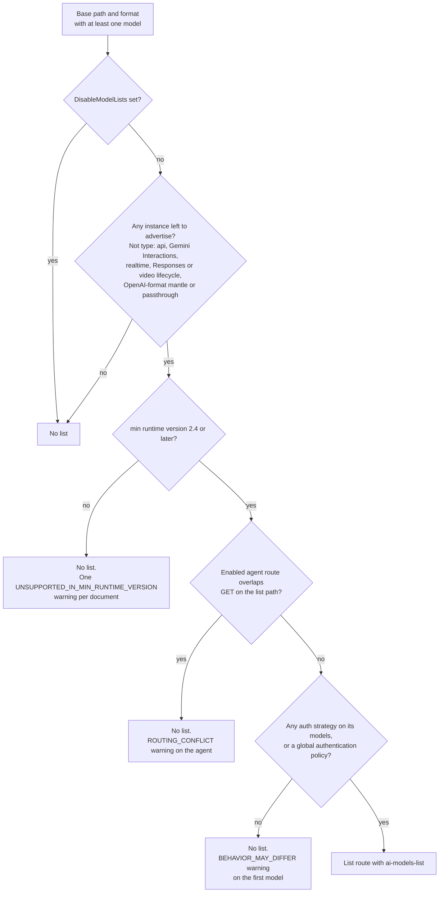

# Motivation
[motivation]: #motivation

A coding agent asks its gateway which models it may use, at the list endpoint
of the API format it speaks: `<base>/v1/models` for Anthropic, `<base>/models`
for OpenAI. Kong AI Gateway has no such endpoint, so every machine carries a
hand-written model list that goes stale whenever an admin adds or removes a
model.

The list this RFC adds returns the virtual models that an admin declares, one
entry per model alias. It does not return the upstream targets behind a model.

The data plane learns to serve the list in a new `ai-models-list` plugin. The
converter emits one list route per base path and format with that plugin on
it. Nothing on the control plane makes such a route today, so Konnect cannot
offer the list.

# Scope
[scope]: #scope

In scope:

- One list route per model base path and format, for the `openai` and the
  `anthropic` formats. The root `/` is a base path like any other.
- One `ai-models-list` plugin on each list route, with one source per
  `ai-proxy-advanced` instance that its models emit. Each source carries the
  model's `access.acls` as its access rule.
- The auth strategies of the listed models on the list route.
- No list on a base path where no auth plugin would identify the caller.
- No list where an agent route already answers `GET` at the list path
  (AIXSM-104).
- A conversion option that turns lists off.
- The 2.4 runtime gate, and revert dropping list routes.

Out of scope:

- The `ai-models-list` plugin itself, including how it evaluates access rules
  per caller. A kong-ee change builds it from the `serve-model-list` filters
  that kong-ee #24216 added to `ai-proxy-advanced`, and removes
  `route_type: llm/v1/models` from `ai-proxy-advanced` before 2.4 ships.
- Lists for the other formats, such as `gemini` and `bedrock`. Their clients
  use other list paths.
- OpenAI-format lists for Bedrock mantle targets. A mantle route serves the
  OpenAI format under `/v1` and `/openai/v1`, so its clients look for a list
  at paths that this RFC does not make. Anthropic-format mantle targets share
  the normal `<base>/v1/messages` route and list normally.
- Display names, descriptions and token limits on list entries. See
  [Entry fields](#entry-fields).
- An admin switch for lists, and a per-model exclude. Either can follow if a
  customer asks.

# Guide-level explanation
[guide-level-explanation]: #guide-level-explanation

A list sits where the clients of a format look for it. An Anthropic-format
model routes `<base>/v1/messages`, so its list is at `<base>/v1/models`. An
OpenAI-format model routes `<base>/chat/completions`, so its list is at
`<base>/models`. A model with both formats appears on both lists.

A model declared on `/claude-code` with the Anthropic format makes a list at
`/claude-code/v1/models`. A model declared on the root `/` makes a list at the
root, `/v1/models` or `/models`. A model without `config.route.paths` counts as
declared on `/`. The root list shows only the models declared on `/`, not
every model on the gateway. A model declared on several base paths appears on
the list of each one.

A list shows virtual models only, one entry per alias however many targets
the model has. The entry id is the alias that a client sends to select the
model. A model without `config.route.model.values` uses its name as its alias.
A model with several values gets one entry for each value, and its name does
not appear. The gateway builds each entry from the model's targets, so the
list needs no second source of truth.

A passthrough model is not listed. A base path whose models are all passthrough gets no list, its passthrough route already forwards the list request to the provider's own list. On a base
path that also has virtual models, the list shows only the virtual models.

A model's `access.acls` becomes the access rule of its list sources. The
gateway hides a model from a caller the rule excludes, as the acl plugin
rejects that caller on the model route. One exception: a CEL rule that reads
the request (`http.*`, `route.*` or `service.*`) hides the model from every
caller.

A list needs an authenticated caller. A base path whose list route would
carry no auth plugin gets no list, and the converter warns the admin.

Some admins already answer the list path with an agent. Konnect keeps that
agent route, makes no list on its path and warns the admin.

## Example

An admin declares five models. Targets, providers and auth strategies are
left out:

```yaml
models:
  - name: claude-sonnet
    formats: [{type: anthropic}]
    config: {route: {paths: [/claude-code]}}
    access:
      auth_strategies: [okta-oidc]
  - name: claude-opus
    formats: [{type: anthropic}]
    config: {route: {paths: [/claude-code]}}
    access:
      auth_strategies: [okta-oidc]
      acls: {deny: [contractors]}
  - name: gpt-5-4
    formats: [{type: openai}]
    access:
      auth_strategies: [team-keys]
  - name: gpt-open
    formats: [{type: openai}]
    config: {route: {paths: [/open]}}
  - name: openai-raw
    formats: [{type: passthrough}]
    config: {route: {paths: [/raw]}}
```

The converter makes two lists:

| Base path | List path | Shows | Why |
|---|---|---|---|
| `/claude-code` | `GET /claude-code/v1/models` | `claude-opus`, `claude-sonnet` | Both Anthropic-format models are declared on `/claude-code`. |
| `/` | `GET /models` | `gpt-5-4` | `gpt-5-4` sets no path, so it is on `/`. The root lists only the models declared on `/`. |
| `/open` | none | | `gpt-open` has no auth strategy, so no plugin can identify a caller. The converter warns. |
| `/raw` | none | | `openai-raw` is passthrough. Its route forwards the list request to the provider. |

Each caller of `/claude-code/v1/models` sees a different list:

| Caller | Response |
|---|---|
| Okta user, not in `contractors` | `claude-opus`, `claude-sonnet` |
| Okta user in `contractors` | `claude-sonnet` |
| No credentials | Rejected by `openid-connect` (401 for a bearer-only strategy) |



The response format follows the request, not the path. A request with an
`anthropic-version` header gets the Anthropic format:

```json
{
  "data": [
    {"type": "model", "id": "claude-opus"},
    {"type": "model", "id": "claude-sonnet"}
  ],
  "has_more": false,
  "first_id": "claude-opus",
  "last_id": "claude-sonnet"
}
```

Other requests get the OpenAI format, here from `GET /models`:

```json
{
  "object": "list",
  "data": [
    {"id": "gpt-5-4", "object": "model", "created": 0, "owned_by": "kong"}
  ]
}
```

An entry also carries `cost` when the gateway knows the price of the target
model. See [Entry fields](#entry-fields) for the fields it cannot carry yet.

# Reference-level explanation
[reference-level-explanation]: #reference-level-explanation

## List routes

`convertModelLists` runs after the agent pass and before the routing conflict
check. It groups the instance ids that each model emits by list path, which
it computes from the base path and the instance's `llm_format`. Only the
`openai` and `anthropic` groups make a list. The key is the computed path, not
the raw base path: `aimap.RoutePath` trims a trailing slash, so `/team` and
`/team/` share one list. Each instance id appears once in a list's `sources`,
because the gateway rejects a config with a repeated `plugin_id`.

Each group with at least one source emits one route, `<format>-models` for the
root and `<format>-models-<base>` for the others. The `<base>` part replaces
each character that a Kong name does not accept with `-`. A name that another
route already uses takes a counter suffix, as `uniqueModelRouteName` gives
model routes. The route matches `GET` on
`aimap.RoutePath(base, aimap.ModelListSpecs[format])`, where `ModelListSpecs`
maps `openai` to `/models` and `anthropic` to `/v1/models`, and carries one
route-scoped `ai-models-list` plugin:

```yaml
plugins:
  - name: ai-models-list
    route: anthropic-models-team-a
    config:
      sources:
        - plugin_id: c32e7c3e-b43c-56b9-bf90-d660df5cd572
          access: {deny: [contractors]}
```

A model emits one `ai-proxy-advanced` instance for each route and alias it
makes, for example one per capability and one per value of
`config.route.model.values`. Those instances stay on the model routes and
never answer a list request. The list plugin names each of them as a source.
All instances of one alias advertise the same id. The gateway keeps the first
entry for an id that the caller may see, so a model with several capabilities
still gets one entry per alias.

For the `/claude-code` models of the example, the output looks like this.
Each box is a route with its plugins. Dashed lines are list sources:



The list never sends a request through the `ai-proxy-advanced` instances. It
reads their targets from the gateway configuration. The `acl` plugin keeps
guarding inference on the model route.

`ai-models-list` has no `acls` field. The `config.acls` of `ai-proxy-advanced`
cannot hold the CEL rules (`allow_when`, `deny_when`) that a model's access
rule can hold. `sources[].access` carries all four acl fields.

The gateway cannot evaluate a CEL rule that reads `http.*`, `route.*` or
`service.*` on a list request, so it hides such a source from every caller,
for `allow_when` and `deny_when` alike. The acl plugin still evaluates the
rule on the model route. The converter copies the rule as it is and reports
no issue, because it has no CEL parser and cannot tell which variables a rule
reads. The gateway decides, so the list never shows the model to a caller the
rule could exclude.

## Source ids

`sources[].plugin_id` needs an id that survives a reload, so each advertised
`ai-proxy-advanced` instance carries an `id` derived from its route name and
rendered config (`kong.StableUUID`). The rendered config decides it, not the
model name or alias, because revert recovers those differently and the round
trip must stay byte-identical.

Two models with the same alias, route and targets render the same config.
RFC 00229 reports that input as a `ROUTING_CONFLICT`, but the data plane
accepts it, and equal ids would make it reject the whole config. So the
second such instance also hashes an occurrence count (`2`, then `3`). The
first hashes none, so configs without such a pair keep their ids.

## Entry fields

The gateway reads `display_name`, `description`, `max_input_tokens`,
`max_tokens` and `capabilities` only from `targets[].metadata`. The converter
writes no `metadata` record, and the AI Gateway model has no field for the
limits. So a list entry carries the alias and, when the gateway knows
the price, `cost`. Mapping the model's `display_name` into target `metadata`
can follow in its own change.

## Authentication

The list route carries the union of the auth strategies of the models grouped
onto it. With more than one strategy, the same anonymous consumer and
`request-termination` the model routes use protect the route: a caller that
matches no strategy reaches the anonymous consumer, which answers 401. With
one strategy, the strategy's own plugin rejects such a caller.

With no strategy and no global authentication policy, the list route would
carry no auth plugin. The gateway answers 401 to every caller it cannot
identify, so that list would never answer. The converter makes no list for
that group and reports one `BEHAVIOR_MAY_DIFFER` warning on its first model,
at `access.auth_strategies`. A global authentication policy covers the list
route as it covers the model routes, so the list stays.

When only some models of a group set a strategy, the union is not empty and
the list stays. A caller without credentials can then call a model that sets
no strategy, but cannot read the list.

A model whose `access.acls` sets more than one of `allow`, `deny`,
`allow_when` and `deny_when` never reaches this step: its acl plugin fails, so
the model fails first.

A list route matches on its path only. A model route also matches on hosts,
SNIs and headers, so a caller those rules exclude can still read the list.
The list is a discovery surface, not an inference surface.

The list route accepts `https` only when a model route of its group excludes
`http` through `config.route.protocols`. Otherwise it accepts `http` and
`https`. A caller then cannot send credentials in plain text to a list whose
models accept only TLS.

## Instances left out

The gateway advertises a target only by its `model_alias`. The converter
leaves these instances out of every list:

- `type: api` (files, batches). Its requests carry no model, so its targets
  stay alias-less to remain in the gateway's default balancer pool.
- Gemini Interactions. `withModelAlias` sets no alias on its targets.
- Realtime (`ws`/`wss`). Its targets carry no alias, and a plain HTTP caller
  cannot reach a WebSocket-only route.
- The Responses lifecycle (`aimap.IsLifecycleEndpoint`) and the video
  lifecycle. They serve stored work, not a model a client selects.
- Passthrough. Its targets carry `route_type: passthrough`, so there is no
  virtual model to list.
- OpenAI-format Bedrock mantle. Its routes keep mantle targets in their own
  instance. See [Scope](#scope).

A model whose instances are all left out appears on no list, but its auth
strategies still join the union of the lists it was grouped onto. A group
whose instances are all left out gets no list.

## Which groups get a list

A group is one base path with one format, `openai` or `anthropic`.



## Existing GET route

For a group with an instance to advertise, the converter checks the agent
routes with the overlap rules of RFC 00229. An agent route that matches `GET`
on the list path keeps its path. The converter makes no list for that group
and reports a `ROUTING_CONFLICT` warning on the agent that names the list
path. Two routes with equal paths would tie otherwise, and which one wins is
undefined.

Two kinds of agent do not suppress the list:

- A disabled agent (`enabled: false`). Its Gateway Service answers nothing.
- An agent route that refines the list route under RFC 00229: it adds `hosts`
  or `headers`, and its `methods` and `protocols` are within the list route's.
  Kong sends a request that matches the refinement to the agent, and every
  other request to the list. An agent with `hosts` but no `methods` does not
  refine the list route, so it still suppresses the list.

For example, an admin serves a static list for `/claude-code` with an agent:

```yaml
agents:
  - name: model-catalog
    type: http
    config:
      url: https://catalog.internal/models
      route: {paths: [/claude-code/v1/models], methods: [GET]}
```

`/claude-code` gets no Anthropic-format list, and the agent gets one warning:

```yaml
- code: ROUTING_CONFLICT
  severity: WARNING
  source:
    kind: agent
    name: model-catalog
    fields:
      - config.route
  reason: <names the list path /claude-code/v1/models>
```

## Conversion option

`Options.DisableModelLists` turns lists off. When it is set, the converter
makes no list route and gives no instance an `id`. It defaults to false, so
lists are on. Konnect holds the switch to turn lists off during the rollout.
Admins get no switch.

## Runtime gate

`aimap.FeatureModelLists` gates the list on 2.4. A 2.3 data plane has no
`ai-models-list` plugin and rejects the list route. Below the gate the
converter makes no list route and gives no instance an `id`. Unless lists are
off, a document with at least one instance to advertise also gets one
`UNSUPPORTED_IN_MIN_RUNTIME_VERSION` warning that names the minimum runtime
version the list needs. A document with nothing to advertise gets no warning.

## Revert

Revert drops a route that carries an `ai-models-list` plugin. The list route
has no AI Gateway entity, so it must not become a model.

`aimap.ModelListPlugin` and `aimap.ModelListSpecs` hold the constants, shared
by both directions.

# Drawbacks
[drawbacks]: #drawbacks

- The list depends on a gateway plugin that does not exist yet. The kong-ee
  change must land before 2.4 ships, or the converter has nothing to emit.
- Anthropic-format clients such as Claude Code keep only ids that contain
  `claude` or `anthropic`. The gateway serves other ids, such as `gpt-5-4`,
  and logs a warning, but Claude Code does not show them.
- On 2.4 and later, every advertised `ai-proxy-advanced` instance carries an
  `id`. The field is valid in decK and db-less output, but it widens the diff.
  Output below the gate does not change.
- A model declared on several base paths is advertised on several lists, so
  the same instance id repeats. The gateway deduplicates per caller.
- Existing golden cases with a model to list but no auth gain the
  `BEHAVIOR_MAY_DIFFER` warning of [Authentication](#authentication).
- The gateway logs a warning on each rebuild for each id that more than one
  source advertises. Every model with several capabilities logs one. The
  kong-ee change can drop that warning for instances of one alias.
- Two models in one group with different auth strategies share one route and
  one union of strategies. A caller authenticated by one strategy
  can discover a model the other strategy guards, unless the model also sets
  an access rule.

# Rationale and alternatives
[rationale-and-alternatives]: #rationale-and-alternatives

- Serve the list from `ai-proxy-advanced` with `route_type: llm/v1/models`,
  as kong-ee #24216 does. Rejected: it gives one plugin two jobs. Its schema
  needs special cases: `targets` is required unless `route_type` is set, and
  `config.acls` is rejected in list mode. The top-level `route_type` is easy
  to confuse with `targets[].route_type`. 2.4 is not released, so moving the
  mode to its own plugin breaks no user.
- Build the list with a `post-function` plugin, which needs no data plane
  change. Rejected: the converter would write Lua into the config that no
  schema validates. That Lua must repeat the acl plugin's matching, CEL rules
  included, and render both formats, so each acl change needs a second edit.
  Its gain, lists on data planes older than 2.4, shrinks as they upgrade.
- Build the list with `response-transformer`. Rejected: it returns the same
  body to every caller, so it cannot apply a per-caller access rule.
- Build the list with Datakit. Rejected: it would repeat the acl plugin's
  matching without the CEL rules.
- Generate the lists in Konnect instead of the converter. Rejected: write-time
  validation runs the same converter, so a second implementation could accept
  a config the data plane rejects.
- Serve every list at `<base>/v1/models`. Rejected: outside Bedrock mantle,
  OpenAI-format routes have no `/v1` (`<base>/chat/completions`), so an OpenAI
  client asks for `<base>/models` and finds nothing.
- List every model of the gateway at the root. Rejected: the root route would
  carry the union of the auth strategies of every model. A root that acts like
  any other base path lists only the models declared on it.
- Reference the source instances by name. Rejected: the `sources` schema
  accepts a plugin id only.
- Put the model's ACL plugins on the list route. Rejected: the gateway reads a
  source's rule per model, so a route-scoped rule would hide or show the whole
  list.
- Split a list by auth strategy, as the model routes split. Rejected: a list
  route matches on its path only, so two lists on one path would match the
  same requests: the routing conflict RFC 00229 reports.
- Suppress the list of a group whose models disagree on auth strategies.
  Rejected: two models that disagree would strip discovery from every model in
  their group. Merging keeps every per-model rule, because each source still
  carries the access rule of its model. The cost is the last drawback above.

# Unresolved questions
[unresolved-questions]: #unresolved-questions

None.

# Testing
[testing]: #testing

New golden cases:

- `140_model_lists`: one model without `config.route.paths`, and two
  models on two other base paths, all with an auth strategy. One model has
  `access.acls` that denies a consumer group. Its output covers a root list
  with only the root model, one list per base path and a source access rule.
- `141_model_lists_formats`: a model with the `openai` and the
  `anthropic` format is on `<base>/models` and on `<base>/v1/models`. A
  `gemini`-format model makes no list.
- `142_model_lists_passthrough`: a base path with only passthrough
  models gets no list and no warning, even without an auth strategy. A base
  path with a passthrough and a virtual model lists only the virtual model.
- `143_model_lists_agent_get_route`: an agent on
  `/claude-code/v1/models` keeps its route, `/claude-code` gets no
  Anthropic-format list, and the agent gets one `ROUTING_CONFLICT` warning. A
  disabled agent and an agent with `hosts` and `methods: [GET]` on the same
  path leave the list in place. An agent with `hosts` and no `methods` still
  suppresses it.
- `144_model_lists_disabled`: `DisableModelLists` in `options.yaml`
  makes no list route and gives no instance an `id`.
- `145_model_lists_no_auth`: a base path with a model to list but no auth
  strategy gets no list and one `BEHAVIOR_MAY_DIFFER` warning.
- `146_model_lists_global_auth`: the same input with a global authentication
  policy gets the list.
- `147_model_lists_aliases`: a model with two `config.route.model.values`
  gets two entries, and a base path with only `type: api` models gets no list.
- `148_model_lists_request_conditions`: a model whose `deny_when` reads
  `http.headers` gets a source that carries the rule as it is, with no issue.
- `149_model_lists_duplicate_alias`: two models with the same alias,
  route and targets get two distinct instance ids.
- `150_model_lists_paths`: a model on `/team` and `/team/` gets one
  list with each instance id once, and a model with
  `config.route.protocols: [https]` gets an https-only list route.

Existing golden cases:

- Every below-gate `min_runtime_*` golden case with an instance to advertise
  asserts the 2.4 gate: no list route, no instance `id`, and one
  `UNSUPPORTED_IN_MIN_RUNTIME_VERSION` warning for the list route. A
  below-gate case with only passthrough or `type: api` models gets no
  warning.
- The realtime golden cases (`100_wildcard_realtime_global_auth`,
  `102_wildcard_realtime_auth_strategies`, `107_realtime_log_payloads`)
  advertise no `ws`/`wss` instance. The case
  `101_wildcard_targets_and_video` advertises neither its video lifecycle nor
  its `openai-responses-lifecycle` instance. `105_wildcard_bedrock_mantle`
  advertises no OpenAI-format mantle instance.
- The auth-strategy golden cases (`51_auth_strategies`,
  `52_auth_strategies_multi`, `24_identity_providers`,
  `25_identity_providers_multi`, `102_wildcard_realtime_auth_strategies`)
  assert the auth plugins of the list routes.
- `revert/roundtrip_test.go` keeps every forward golden byte-identical, so
  the revert half of the round trip drops each list route.

End-to-end cases in `e2e/`, on a 2.4 gateway image:

- A caller sees only the models its access rule allows, in both the OpenAI
  and the Anthropic format.
- An OpenAI client lists at `<base>/models`, and an Anthropic client lists at
  `<base>/v1/models`.
- The root list shows only the models declared on `/` to an authenticated
  caller.
- A caller that matches no key-auth strategy gets 401.
- On a base path with only passthrough models, the list request reaches the
  provider.
- An agent on a list path keeps answering `GET` there.
