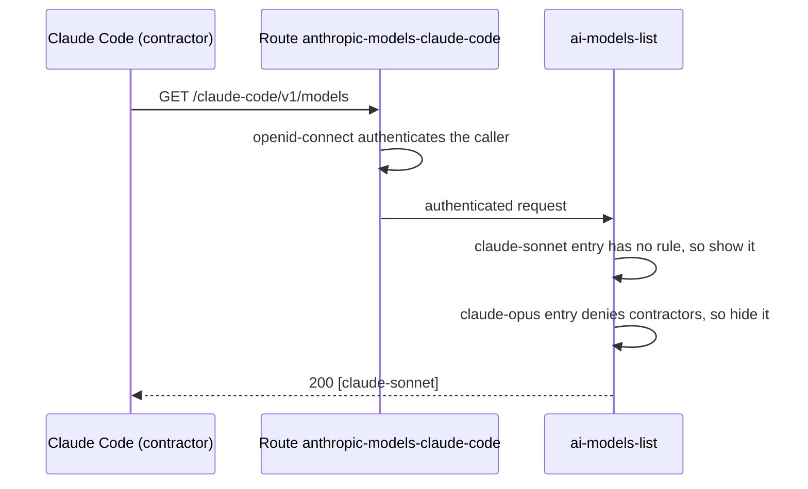
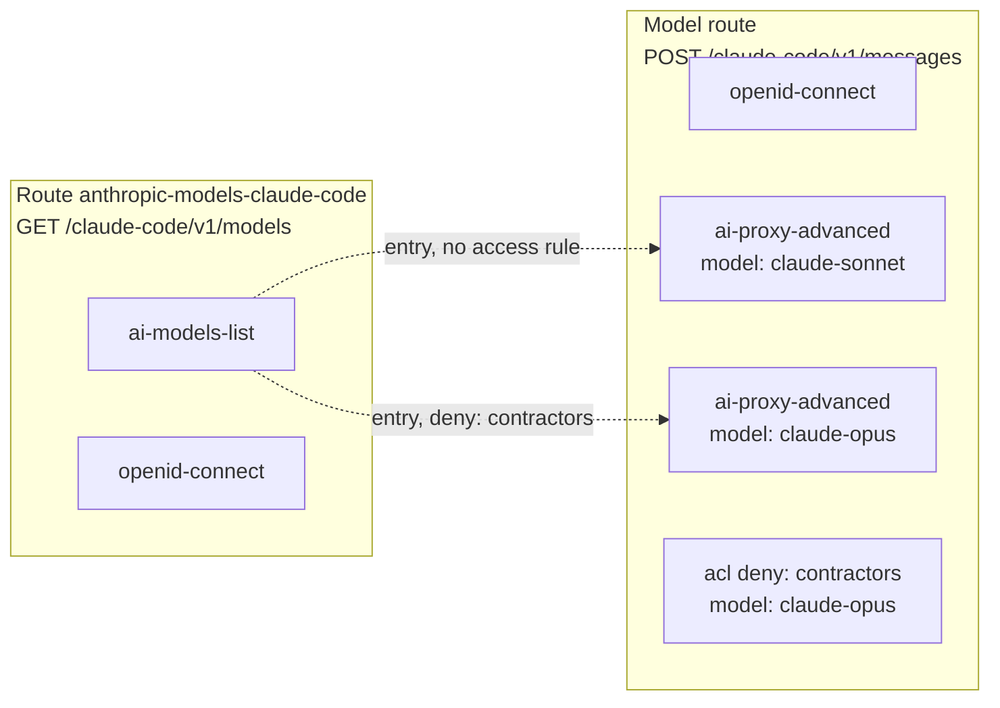
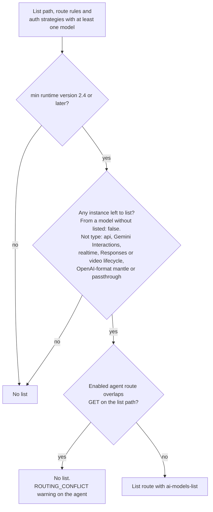

# Motivation
[motivation]: #motivation

A coding agent asks its gateway which models it may use, at the list endpoint
of the API format it speaks: `<base>/v1/models` for Anthropic, `<base>/models`
for OpenAI. Kong AI Gateway has no such endpoint, so every machine carries a
hand-written model list that goes stale whenever an admin adds or removes a
model.

The list this RFC adds returns the virtual models that an admin declares, one
entry per model alias. It does not return the upstream targets behind a model.

The data plane learns to serve the list in a new `ai-models-list` plugin. The
converter emits list routes with that plugin on them, one for each base path,
format and set of model route rules. Nothing on the control plane makes such a
route today, so Konnect cannot offer the list.

# Scope
[scope]: #scope

In scope:

- One list route for each base path, format and set of model route rules,
  for the `openai` and the `anthropic` formats. The root `/` is a base path
  like any other.
- One `ai-models-list` plugin on each list route, with one entry per alias
  that its models serve. Each entry carries the alias, the format and the
  model's `access.acls` as its access rule.
- On each list route, the route rules and auth strategies of its model
  routes.
- A public list, with no auth plugin, on a base path whose models set no auth
  strategy.
- No list where an agent route already answers `GET` at the list path
  (AIXSM-104).
- Lists on by default from 2.4, and a per-model setting,
  `config.model.listed`, that takes a model off its lists.
- The 2.4 runtime gate, and revert dropping list routes.

Out of scope:

- The `ai-models-list` plugin itself, including how it evaluates access rules
  per caller. A kong-ee change builds it from the `serve-model-list` filters
  that kong-ee #24216 added to `ai-proxy-advanced`, and removes
  `route_type: llm/v1/models` from `ai-proxy-advanced` before 2.4 ships.
  [List routes](#list-routes), [Entry fields](#entry-fields) and
  [Authentication](#authentication) say where the plugin must differ from the
  filters.
- Lists for the other formats, such as `gemini` and `bedrock`. Their clients
  use other list paths.
- OpenAI-format lists for Bedrock mantle targets. A mantle route serves the
  OpenAI format under `/v1` and `/openai/v1`, so its clients look for a list
  at paths that this RFC does not make. Anthropic-format mantle targets share
  the normal `<base>/v1/messages` route and list normally.
- Display names, descriptions, token limits and prices on list entries. See
  [Entry fields](#entry-fields) and [Follow-ups](#follow-ups).
- A gateway-wide switch for lists. It can follow if a customer asks.

# Guide-level explanation
[guide-level-explanation]: #guide-level-explanation

A list sits where the clients of a format look for it. An Anthropic-format
model routes `<base>/v1/messages`, so its list is at `<base>/v1/models`. An
OpenAI-format model routes `<base>/chat/completions`, so its list is at
`<base>/models`. A model with both formats appears on both lists.

The two paths follow the SDKs. The Anthropic SDK takes a base URL without
`/v1` and adds `/v1/messages` or `/v1/models`. The OpenAI SDK takes a base URL
and adds `/chat/completions` or `/models`. So a client whose base URL ends in
the base path finds the list with no other setting.

A model declared on `/claude-code` with the Anthropic format makes a list at
`/claude-code/v1/models`. A model declared on the root `/` makes a list at the
root, `/v1/models` or `/models`. A model without `config.route.paths` counts as
declared on `/`. The root list shows only the models declared on `/`, not
every model on the gateway. A model declared on several base paths appears on
the list of each one.

A list shows virtual models only, one entry per alias however many targets
the model has. The entry id is the alias that a client sends to select the
model. A model without `config.route.model.values` uses its name as its alias.
A model with several values gets one entry for each value, and its name does
not appear. The converter writes each entry from the model, so the list needs
no second source of truth.

A passthrough model is not listed. A base path whose models are all passthrough gets no list, its passthrough route already forwards the list request to the provider's own list. On a base
path that also has virtual models, the list shows only the virtual models.

A model's `access.acls` becomes the access rule of its list entries. The
gateway hides a model from a caller the rule excludes, as the acl plugin
rejects that caller on the model route. One exception: a CEL rule that reads
the request (`http.*`, `route.*` or `service.*`) shows the model to every
caller, and the converter warns the admin.

A list matches the same hosts, headers and SNIs as its model routes, and uses
their auth strategies. So a caller sees the models that its requests reach. A
base path whose models set no auth strategy gets a public list, because its
models are public too. A public list shows only the models without an access
rule.

Some admins already answer the list path with an agent. Konnect keeps that
agent route, makes no list on its path and warns the admin.

## Example

An admin declares five models. Targets, providers and auth strategies are
left out:

```yaml
models:
  - name: claude-sonnet
    formats: [{type: anthropic}]
    config: {route: {paths: [/claude-code]}}
    access:
      auth_strategies: [okta-oidc]
  - name: claude-opus
    formats: [{type: anthropic}]
    config: {route: {paths: [/claude-code]}}
    access:
      auth_strategies: [okta-oidc]
      acls: {deny: [contractors]}
  - name: gpt-5-4
    formats: [{type: openai}]
    access:
      auth_strategies: [team-keys]
  - name: gpt-open
    formats: [{type: openai}]
    config: {route: {paths: [/open]}}
  - name: openai-raw
    formats: [{type: passthrough}]
    config: {route: {paths: [/raw]}}
```

The converter makes three lists:

| Base path | List path | Shows | Why |
|---|---|---|---|
| `/claude-code` | `GET /claude-code/v1/models` | `claude-opus`, `claude-sonnet` | Both Anthropic-format models are declared on `/claude-code`. |
| `/` | `GET /models` | `gpt-5-4` | `gpt-5-4` sets no path, so it is on `/`. The root lists only the models declared on `/`. |
| `/open` | `GET /open/models` | `gpt-open` | `gpt-open` sets no auth strategy, so its list is public too. |
| `/raw` | none | | `openai-raw` is passthrough. Its route forwards the list request to the provider. |

Each caller of `/claude-code/v1/models` sees a different list:

| Caller | Response |
|---|---|
| Okta user, not in `contractors` | `claude-opus`, `claude-sonnet` |
| Okta user in `contractors` | `claude-sonnet` |
| No credentials | Rejected by `openid-connect` (401 for a bearer-only strategy) |

`team-keys` is a `key-auth` strategy. Callers of `GET /models` get:

| Caller | Response |
|---|---|
| A valid `team-keys` key | `gpt-5-4` |
| No key, or an unknown key | Rejected by `key-auth` (401) |

Every caller of `GET /open/models` gets `gpt-open`.



The response format follows the request, not the path. A request with an
`anthropic-version` header gets the Anthropic format:

```json
{
  "data": [
    {"type": "model", "id": "claude-opus"},
    {"type": "model", "id": "claude-sonnet"}
  ],
  "has_more": false,
  "first_id": "claude-opus",
  "last_id": "claude-sonnet"
}
```

Other requests get the OpenAI format, here from `GET /models`:

```json
{
  "object": "list",
  "data": [
    {"id": "gpt-5-4", "object": "model", "created": 0, "owned_by": "kong"}
  ]
}
```

An entry carries no price. See [Entry fields](#entry-fields) for the fields
it cannot carry yet.

# Reference-level explanation
[reference-level-explanation]: #reference-level-explanation

## List routes

`convertModelLists` runs after the agent pass and before the routing conflict
check. It groups the aliases that each model's `ai-proxy-advanced` instances
serve by a key with three parts:

- The list path, which it computes from the base path and the instance's
  `llm_format`. Only the `openai` and `anthropic` formats make a list. The key
  holds the computed path, not the raw base path: `aimap.RoutePath` trims a
  trailing slash, so `/team` and `/team/` share one list.
- The route rules of the model route: `hosts`, `headers`, `snis`, `sources`,
  `destinations` and `protocols` from `config.route`. Paths and methods stay
  out, because the list route has its own.
- The auth strategies of the model, the `authStrategyKey` that the model routes
  already split on.

So models share a list route only when their model routes match requests the
same way. Kong picks a list route by the same rules as a model route, so a
caller sees the models that its requests reach. A model on an internal host
does not appear on the list of a public host.

An OpenAI-format model on `/v1` and an Anthropic-format model on `/` with
equal rules share the list path `/v1/models`, so they share one list route.
`ai-models-list` picks the response format per request from the
`anthropic-version` header. The kong-ee change must also make it serve only
the entries whose `format` matches that format: an OpenAI client on `/v1`
cannot call the Anthropic model, whose route is `/v1/messages`.

Each group with at least one entry emits one route, `<format>-models` for the
root and `<format>-models-<base>` for the others. A route that serves both
formats takes the `openai` name. The `<base>` part replaces each character
that a Kong name does not accept with `-`. A name that another
route already uses takes a counter suffix, as `uniqueModelRouteName` gives
model routes. The route matches `GET` on
`aimap.RoutePath(base, aimap.ModelListSpecs[format])`, where `ModelListSpecs`
maps `openai` to `/models` and `anthropic` to `/v1/models`, and carries one
route-scoped `ai-models-list` plugin:

```yaml
plugins:
  - name: ai-models-list
    route: anthropic-models-team-a
    config:
      models:
        - name: claude-opus
          format: anthropic
          access: {deny: [contractors]}
```

A model emits one `ai-proxy-advanced` instance for each route and alias it
makes, for example one per capability and one per value of
`config.route.model.values`. The converter writes each alias of a model once
per list, however many instances serve it. Two models with the same alias on
one list each get an entry, and the gateway shows the alias once, from the
first entry that the caller may see.

For the `/claude-code` models of the example, the output looks like this.
Each box is a route with its plugins. Dashed lines join each entry to the
model it lists:



The list never sends a request through the `ai-proxy-advanced` instances, and
it does not read them. The `acl` plugin keeps guarding inference on the model
route.

`ai-models-list` has no `acls` field. The `config.acls` of `ai-proxy-advanced`
cannot hold the CEL rules (`allow_when`, `deny_when`) that a model's access
rule can hold. `models[].access` carries all four acl fields.

The gateway cannot evaluate a CEL rule that reads `http.*`, `route.*` or
`service.*` on a list request, so it shows such an entry to every caller, for
`allow_when` and `deny_when` alike. The acl plugin still evaluates the rule on
the model route. A hidden model gives the caller no reason. A refusal on the
model route says why. Today the `serve-model-list` filter hides such a model,
so the kong-ee change must make `ai-models-list` show it.

The converter copies the rule as it is. It has no CEL parser, so it matches the
rule text against `http.`, `route.` and `service.`. On a match it reports one
`BEHAVIOR_MAY_DIFFER` warning at `access.acls` that says the list shows the
model to every caller. A match inside a string literal is a false positive, but
it costs only a warning. An admin clears the warning by setting
`config.model.listed: false` on the model, which takes it off every list.

## Entry fields

An entry has three fields: `name`, the alias; `format`, the instance's
`llm_format`; and `access`, the model's `access.acls`. The `serve-model-list`
filter reads `display_name`, `description`, `max_input_tokens`, `max_tokens`,
`capabilities` and `cost` from the targets. `ai-models-list` does not read the
targets, so a list response carries none of these fields. See [Follow-ups](#follow-ups).

## Authentication

The models of a list route share one set of auth strategies, so the list
route gets the auth plugins of their model routes. With more than one
strategy, the same anonymous consumer and `request-termination` the model
routes use protect the route: a caller that matches no strategy reaches the
anonymous consumer, which answers 401. With one strategy, the strategy's own
plugin rejects such a caller. A list route never needs two plugins of one
name, because platform-api allows a model at most one strategy of each type.

With no strategy and no global authentication policy, the model routes carry
no auth plugin, and neither does the list route. The list is then public,
like its models. `ai-models-list` serves an unidentified caller only the
entries without an access rule. An entry with a rule needs consumer groups to
match, and the acl plugin rejects that caller on the model route. Today the
`serve-model-list` filter answers 401 to such a caller, so the kong-ee change
must remove that check. A global authentication policy
covers the list route as it covers the model routes.

Models with equal route rules and different auth strategies get separate
model routes that match the same requests. The converter reports them as a
`ROUTING_CONFLICT` today (golden case `92_routing_conflicts`). Their list
routes match the same requests too, and the routing conflict check reports
them the same way.

A model whose `access.acls` sets more than one of `allow`, `deny`,
`allow_when` and `deny_when` never reaches this step: its acl plugin fails, so
the model fails first.

The list route copies `config.route.protocols` with the other route rules, so
a caller cannot send credentials in plain text to a list whose models accept
only TLS.

## Instances left out

The converter lists the alias of an instance only when a client can select a
model by it. It leaves these instances out of every list:

- `type: api` (files, batches). Its requests carry no model, so its targets
  stay alias-less to remain in the gateway's default balancer pool.
- Gemini Interactions. `withModelAlias` sets no alias on its targets.
- Realtime (`ws`/`wss`). Its targets carry no alias, and a plain HTTP caller
  cannot reach a WebSocket-only route.
- The Responses lifecycle (`aimap.IsLifecycleEndpoint`) and the video
  lifecycle. They serve stored work, not a model a client selects.
- Passthrough. Its targets carry `route_type: passthrough`, so there is no
  virtual model to list.
- OpenAI-format Bedrock mantle. Its routes keep mantle targets in their own
  instance. See [Scope](#scope).

A model whose instances are all left out appears on no list. A group whose
instances are all left out gets no list.

## Which groups get a list

A group is one list path with one set of route rules and auth strategies.



## Existing GET route

For a group with an instance to list, the converter checks the agent
routes with the overlap rules of RFC 00229. An agent route that matches `GET`
on the list path keeps its path. The converter makes no list for that group
and reports a `ROUTING_CONFLICT` warning on the agent that names the list
path. Two routes with equal paths would tie otherwise, and which one wins is
undefined.

Two kinds of agent do not suppress the list:

- A disabled agent (`enabled: false`). Its Gateway Service answers nothing.
- An agent route that refines the list route under RFC 00229: it adds `hosts`
  or `headers`, and its `methods` and `protocols` are within the list route's.
  Kong sends a request that matches the refinement to the agent, and every
  other request to the list. An agent with `hosts` but no `methods` does not
  refine the list route, so it still suppresses the list.

For example, an admin serves a static list for `/claude-code` with an agent:

```yaml
agents:
  - name: model-catalog
    type: http
    config:
      url: https://catalog.internal/models
      route: {paths: [/claude-code/v1/models], methods: [GET]}
```

`/claude-code` gets no Anthropic-format list, and the agent gets one warning:

```yaml
- code: ROUTING_CONFLICT
  severity: WARNING
  source:
    kind: agent
    name: model-catalog
    fields:
      - config.route
  reason: <names the list path /claude-code/v1/models>
```

An admin who wants the agent to serve the path without the warning sets
`config.model.listed: false` on every model of the group.

## Per-model setting

Lists are on by default from 2.4. A model sets `config.model.listed: false`
to keep its instances out of every list. A group gets a list when at least
one of its models is listed, so one model never removes the list of the
others.

`config.model.listed` is a boolean next to `config.model.name_header`, with
`x-min-runtime-version: '2.4'`. An unset field means listed.

Like other endpoints, lists come from the model's settings and the runtime
version, not from a converter option. So Konnect needs no change where it
calls the converter.

## Runtime gate

`aimap.FeatureModelLists` gates the list on 2.4. A 2.3 data plane has no
`ai-models-list` plugin and rejects the list route. Below the gate the
converter makes no list route and reports no issue. Lists are on by default,
so a warning there would follow every document, and an admin could not clear
it. A model that sets `config.model.listed` below the gate gets the usual
`UNSUPPORTED_IN_MIN_RUNTIME_VERSION` warning at that field. Konnect rejects
such a request first, through `x-min-runtime-version`.

## Revert

Revert drops a route that carries an `ai-models-list` plugin. The list route
has no AI Gateway entity, so it must not become a model.

`aimap.ModelListPlugin` and `aimap.ModelListSpecs` hold the constants, shared
by both directions.

## Field mapping

This example maps a platform-api model (`AIGatewayModelModel`, ai-gateways
v2) to the data plane config the converter emits for it.

The `ai-models-list` side is complete: the converter sets all three fields of
an entry, `name`, `format` and `access`.

A variant of the example's `claude-opus` that sets one alias in
`model.values`:

```yaml
models:
  - name: claude-opus
    display_name: Claude Opus
    type: model
    capabilities: [generate]
    formats: [{type: anthropic}]
    config:
      route:
        paths: [/claude-code]
        model: {values: [claude-opus-4-7]}
    targets:
      - name: claude-opus-4-7
        provider: anthropic-prod
        config: {type: anthropic}
    access:
      auth_strategies: [okta-oidc]
      acls: {deny: [contractors]}
```

converts to this output. Plugins and fields that do not affect the list are
left out:

```yaml
services:
  - name: ai-gateway
    routes:
      - name: anthropic-messages
        paths: [/claude-code/v1/messages]
        methods: [POST, OPTIONS]
      - name: anthropic-models-claude-code
        paths: [/claude-code/v1/models]
        methods: [GET]
        protocols: [http, https]
plugins:
  - name: ai-proxy-advanced
    route: anthropic-messages
    model: claude-opus-4-7
    config:
      llm_format: anthropic
      targets:
        - model:
            model_alias: claude-opus-4-7
            name: claude-opus-4-7
            provider: anthropic
            options: {anthropic_version: "2023-06-01"}
          route_type: llm/v1/chat
  - name: acl
    route: anthropic-messages
    model: claude-opus-4-7
    config: {deny: [contractors], include_consumer_groups: true}
  - name: openid-connect
    route: anthropic-messages
  - name: ai-models-list
    route: anthropic-models-claude-code
    config:
      models:
        - name: claude-opus-4-7
          format: anthropic
          access: {deny: [contractors]}
  - name: openid-connect
    route: anthropic-models-claude-code
```

A caller of `GET /claude-code/v1/models` outside `contractors` gets one entry,
`claude-opus-4-7`, the alias from `model.values`, not the model name. The
entry has no `display_name` and no `cost`.

# Drawbacks
[drawbacks]: #drawbacks

- The list depends on a gateway plugin that does not exist yet. The kong-ee
  change must land before 2.4 ships, or the converter has nothing to emit.
- Anthropic-format clients such as Claude Code keep only ids that contain
  `claude` or `anthropic`. The gateway serves other ids, such as `gpt-5-4`,
  and logs a warning, but Claude Code does not show them.
- Lists are on by default, so a 2.4 gateway serves a list path that its admin
  did not ask for. The list route carries the route rules and auth strategies
  of its model routes, and each entry keeps the access rule of its model.
- Two models on one base path with equal route rules and different auth
  strategies get list routes that match the same requests. Kong sends each
  list request to one of them, so the callers of the other strategy get no
  list. Their model routes have the same conflict today, and the converter
  warns for both.

# Rationale and alternatives
[rationale-and-alternatives]: #rationale-and-alternatives

- Serve the list from `ai-proxy-advanced` with `route_type: llm/v1/models`,
  as kong-ee #24216 does. Rejected: it gives one plugin two jobs. Its schema
  needs special cases: `targets` is required unless `route_type` is set, and
  `config.acls` is rejected in list mode. The top-level `route_type` is easy
  to confuse with `targets[].route_type`. 2.4 is not released, so moving the
  mode to its own plugin breaks no user.
- Build the list with a `post-function` plugin, which needs no data plane
  change. Rejected: the converter would write Lua into the config that no
  schema validates. That Lua must repeat the acl plugin's matching, CEL rules
  included, and render both formats, so each acl change needs a second edit.
  Its gain, lists on data planes older than 2.4, shrinks as they upgrade.
- Build the list with `response-transformer`. Rejected: it returns the same
  body to every caller, so it cannot apply a per-caller access rule.
- Build the list with Datakit. Rejected: it would repeat the acl plugin's
  matching without the CEL rules.
- Generate the lists in Konnect instead of the converter. Rejected: write-time
  validation runs the same converter, so a second implementation could accept
  a config the data plane rejects.
- Serve every list at `<base>/v1/models`. Rejected: outside Bedrock mantle,
  OpenAI-format routes have no `/v1` (`<base>/chat/completions`), so an OpenAI
  client asks for `<base>/models` and finds nothing.
- List every model of the gateway at the root. Rejected: the root route would
  carry the union of the auth strategies of every model. A root that acts like
  any other base path lists only the models declared on it.
- Name the `ai-proxy-advanced` instances as sources by plugin id, as the
  `serve-model-list` filter does. Rejected: the list needs only the alias and
  the format from them, and the converter knows both. A plugin id needs a
  stable `id` on every listed instance, and a tie-break for two instances
  that render the same config.
- Put the model's ACL plugins on the list route. Rejected: the gateway reads
  an entry's rule per model, so a route-scoped rule would hide or show the
  whole list.
- One list route per base path and format that matches on its path only,
  with the union of its models' auth strategies. Rejected: it shows a model to
  callers that its model route's hosts or headers exclude, so a model on an
  internal host appears on the list of a public host. The union can also hold
  two `openid-connect` strategies, and Kong runs only one plugin of a name on
  a route.
- A converter option that Konnect sets from the runtime version. Rejected:
  other endpoints come from the model's settings and the runtime version, not
  from options. An option also gives an admin no way to take one model off a
  list.
- A `models` capability. Rejected: capabilities and formats describe what one
  model serves, and each routes to that model's provider. The list is one
  endpoint for every model on a path.

# Unresolved questions
[unresolved-questions]: #unresolved-questions

None.

# Follow-ups
[follow-ups]: #follow-ups

- Prices on list entries. A virtual model can route to several targets with
  different prices, so one price per entry can differ from what a request
  costs. Most data planes also take target prices from the LLM pricing
  service, not from the config. `kong.llm.dynamic_pricing.price_loader` polls
  that service at run time. The follow-up decides which price an entry shows.
  The converter can add the provider and upstream model of each target to
  the entry, and `ai-models-list` can read the price per request with
  `price_loader.get_entry_by_provider_model`.
- Display names, token limits and capabilities on list entries. The converter
  can add the model's `display_name` to the entry. The polled catalog carries
  `context_length` and `max_tokens` for each upstream model. A virtual model
  with several targets would show the smallest value. A value set on the
  model needs a new platform-api field.

# Testing
[testing]: #testing

New golden cases, at the default runtime version 2.4:

- `140_model_lists`: one model without `config.route.paths`, and two
  models on two other base paths, all with an auth strategy. One model has
  `access.acls` that denies a consumer group. Its output covers a root list
  with only the root model, one list per base path and an entry access rule.
- `141_model_lists_formats`: a model with the `openai` and the
  `anthropic` format is on `<base>/models` and on `<base>/v1/models`. A
  `gemini`-format model makes no list.
- `142_model_lists_passthrough`: a base path with only passthrough
  models gets no list and no warning. A base path with a passthrough and a
  virtual model lists only the virtual model.
- `143_model_lists_agent_get_route`: an agent on
  `/claude-code/v1/models` keeps its route, `/claude-code` gets no
  Anthropic-format list, and the agent gets one `ROUTING_CONFLICT` warning. A
  disabled agent and an agent with `hosts` and `methods: [GET]` on the same
  path leave the list in place. An agent with `hosts` and no `methods` still
  suppresses it.
- `144_model_lists_unlisted`: the input of `140` where every model sets
  `config.model.listed: false` makes no list route and reports no issue. A
  base path with one listed and one unlisted model lists only the listed one.
- `145_model_lists_no_auth`: a base path whose models set no auth strategy
  gets a list route with no auth plugin, and the converter reports no issue.
- `146_model_lists_global_auth`: the same input with a global authentication
  policy gets the list, and the policy covers the list route.
- `147_model_lists_aliases`: a model with two `config.route.model.values`
  gets two entries, and a base path with only `type: api` models gets no list.
- `148_model_lists_request_conditions`: a model whose `deny_when` reads
  `http.headers` gets an entry that carries the rule as it is, and one
  `BEHAVIOR_MAY_DIFFER` warning that says the list shows the model. A
  `deny_when` that reads none of `http.`, `route.` and `service.` gets no
  warning.
- `149_model_lists_duplicate_alias`: two models with the same alias on one
  base path get one entry each, and a model with two capabilities gets one
  entry.
- `150_model_lists_paths`: a model on `/team` and `/team/` gets one
  list with each alias once, and a model with
  `config.route.protocols: [https]` gets an https-only list route.
- `151_model_lists_route_rules`: two models on `/` with different `hosts` get
  two list routes, each with the hosts of its model route and only its own
  model. Two models with equal route rules and different auth strategies get
  two list routes and a `ROUTING_CONFLICT` warning.
- `152_model_lists_shared_path`: an OpenAI-format model on `/v1` and an
  Anthropic-format model on `/` share one `GET /v1/models` list route with
  an entry of each format.

Existing golden cases at 2.4 with an instance to list gain list routes, so
their expected output is regenerated. The golden cases also cover:

- Every below-gate `min_runtime_*` golden case keeps its output: no list
  route and no list issue. A new below-gate case that sets
  `config.model.listed` gets one `UNSUPPORTED_IN_MIN_RUNTIME_VERSION` warning
  at that field.
- The realtime golden cases (`100_wildcard_realtime_global_auth`,
  `102_wildcard_realtime_auth_strategies`, `107_realtime_log_payloads`)
  list no `ws`/`wss` instance. The case
  `101_wildcard_targets_and_video` lists neither its video lifecycle nor
  its `openai-responses-lifecycle` instance. `105_wildcard_bedrock_mantle`
  lists no OpenAI-format mantle instance.
- The auth-strategy golden cases (`51_auth_strategies`,
  `52_auth_strategies_multi`, `24_identity_providers`,
  `25_identity_providers_multi`, `102_wildcard_realtime_auth_strategies`)
  assert the auth plugins of the list routes.
- `revert/roundtrip_test.go` keeps every forward golden byte-identical, so
  the revert half of the round trip drops each list route.

End-to-end cases in `e2e/`, on a 2.4 gateway image:

- A caller sees only the models its access rule allows, in both the OpenAI
  and the Anthropic format.
- An OpenAI client lists at `<base>/models`, and an Anthropic client lists at
  `<base>/v1/models`.
- The root list shows only the models declared on `/` to an authenticated
  caller.
- A caller that matches no key-auth strategy gets 401.
- A caller on one host does not see a model whose route matches another host.
- On `GET /v1/models` shared by both formats, an Anthropic client sees only
  the Anthropic-format models, and an OpenAI client only the OpenAI-format
  models.
- A model whose access rule reads `http.headers` is on the list for every
  caller.
- On a base path whose models set no auth strategy, a caller without
  credentials gets the models without an access rule.
- On a base path with only passthrough models, the list request reaches the
  provider.
- An agent on a list path keeps answering `GET` there.
- A model with `config.model.listed: false` is not on the list, and its model
  route still serves it.
